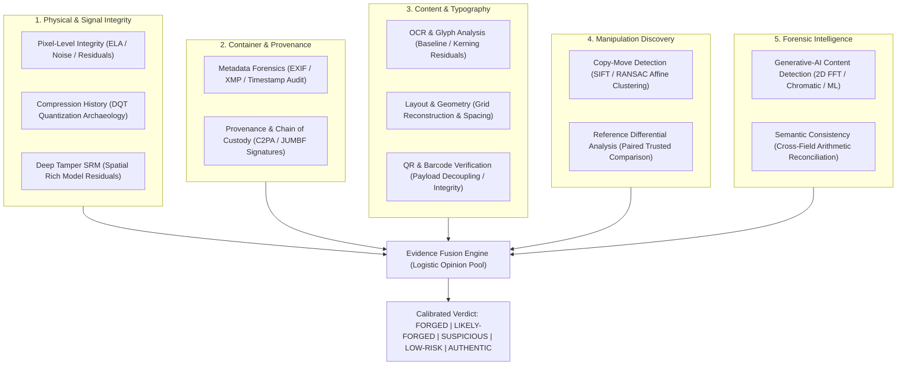

<<<<<<< HEAD
# Forgify — AI Digital Forensics & Document Tampering Detection Platform

<div align="center">


**An evidence-grade, multi-signal digital forensics and generative-AI detection platform for documents, invoices, identity cards, and photography.**

[Overview](#-overview) • [Forensic Architecture](#-forensic-architecture) • [AI Detection Deep Dive](#-ai-generated-image-detection) • [Evidence Fusion](#-evidence-fusion--verdict-calibration) • [Quick Start](#-quick-start) • [API Reference](#-api-reference)

</div>

---

## 🔍 Overview

**Forgify** is a full-stack digital forensics application that analyzes uploaded digital evidence (JPEG, PNG, WebP, TIFF, BMP, HEIC, PDF) for manipulation, splicing, text replacement, copy-move duplication, and synthetic Generative-AI creation.

Unlike simple black-box classifiers, Forgify employs a **defense-in-depth, 11-layer forensic pipeline** that extracts explainable physical, mathematical, optical, and semantic evidence. It cross-corroborates findings through an **evidence fusion engine** to generate an evidence-grade report with per-layer diagnostic metrics, localized heatmaps, and a calibrated risk verdict.

```
┌────────────────────────────────────────────────────────────────────────┐
│                        Uploaded Exhibit / Document                     │
└───────────────────────────────────┬────────────────────────────────────┘
                                    │
           ┌────────────────────────┴────────────────────────┐
           ▼                                                 ▼
┌──────────────────────────────────┐      ┌──────────────────────────────────┐
│   FastAPI Forensics Worker       │      │   Next.js 16 Web Application     │
│   (Port 8000 · Python 3.13)      │◄────►│   (Port 3000 · Node 20+)         │
│   • OpenCV, NumPy, scikit-learn  │      │   • Interactive Workbench        │
│   • 10 Live Forensic Detectors   │      │   • Real-Time Heatmaps & Bounding│
│   • RandomForest AIGC Classifier │      │   • PDF / JSON Evidence Export   │
└──────────────────────────────────┘      └──────────────────────────────────┘
```

---

## 🔬 Forensic Architecture

Forgify executes up to **11 independent forensic layers**, grouped into 5 investigative categories:



### The 11 Forensic Layers

| # | Layer | ID | Category | Weight | Description |
| :- | :--- | :--- | :--- | :--- | :--- |
| **01** | **Pixel-Level Integrity** | `pixel` | Signal | 0.17 | Multi-scale Error-Level Analysis (ELA at 85/90/95 quality), local noise sigma variance, and flat-area residual smoothness (`PX-SMOOTH`). |
| **02** | **Compression History** | `compression` | Signal | 0.10 | Recovers Discrete Quantization Tables (DQT), estimates IJG quality factor, and audits double-JPEG compression grid alignment. |
| **03** | **Metadata Forensics** | `metadata` | Container | 0.12 | EXIF/XMP byte audit, timestamp paradox detection (Created vs Modified), camera hardware model consistency, and software tags. |
| **04** | **Provenance & Custody** | `provenance` | Container | 0.10 | C2PA / JUMBF manifest discovery, asset hash binding, and cryptographic trust chain validation. |
| **05** | **OCR & Glyph Analysis** | `ocr` | Content | 0.08 | Word-level OCR text extraction, character confidence scoring, baseline drift, and font-family substitution detection. |
| **06** | **Layout & Geometry** | `layout` | Content | 0.07 | Grid reconstruction from table rules and margins; logo aspect-ratio paste distortion and interline spacing variance. |
| **07** | **Copy-Move & Splicing** | `copy-move` | Manipulation | 0.13 | SIFT feature descriptor extraction, KD-tree nearest-neighbor matching, and RANSAC affine transformation clustering. |
| **08** | **QR / Barcode Verification**| `qr-barcode` | Content | 0.05 | Visual detection and payload decoding; cross-references decoded payload against visible OCR text and validates Reed-Solomon bitstreams. |
| **09** | **Semantic Consistency** | `semantic` | Intelligence | 0.08 | Cross-field arithmetic verification (subtotals, taxes, line items, grand totals, date order logic, marksheet totals). |
| **10** | **Generative-AI Detection** | `aigc` | Intelligence | 0.14 | 2D Fourier power spectrum grid spikes, chromatic covariance, and calibrated Random Forest machine learning classification. |
| **11** | **Multi-scale Residual (SRM)**| `deep-tamper-srm` | Signal | 0.06 | Spatial Rich Model high-pass filters extracting high-frequency spatial residuals to expose localized splice boundaries. |

---

## 🤖 AI-Generated Image Detection

Forgify features a dedicated engine for detecting **AI-generated imagery and synthetic forged documents** (e.g. Google Gemini/Imagen, Midjourney, DALL-E, Stable Diffusion, and Flux).

### How It Works: The 4 Forensic Pillars

```
┌────────────────────────────────────────────────────────────────────────┐
│                        Input Image / Document                          │
└───────────────────────────────────┬────────────────────────────────────┘
                                    │
    ┌───────────────────┬───────────┴───────────┬───────────────────┐
    ▼                   ▼                       ▼                   ▼
┌──────────────┐ ┌──────────────┐       ┌──────────────┐    ┌──────────────┐
│ 1. 2D FFT    │ │ 2. Spatial   │       │ 3. Chromatic │    │ 4. Structural│
│    Spectral  │ │    Noise &   │       │    Residual  │    │    & QR      │
│    Power     │ │    Denoising │       │    Variance  │    │    Integrity │
│              │ │              │       │              │    │              │
│ Periodic     │ │ Diffusion    │       │ Latent tensor│    │ Hallucinated │
│ upsampler    │ │ denoising    │       │ color channel│    │ glyphs & non-│
│ grid spikes  │ │ smoothness   │       │ decoupling   │    │ decodable QR │
└──────┬───────┘ └──────┬───────┘       └──────┬───────┘    └──────┬───────┘
       │                │                      │                   │
       └────────────────┴───────────┬──────────┴───────────────────┘
                                    ▼
                ┌───────────────────────────────────────┐
                │   Calibrated Random Forest Model      │
                │   (10-Dimensional Feature Vector)     │
                └───────────────────┬───────────────────┘
                                    ▼
                ┌───────────────────────────────────────┐
                │   AIGC Score & Severity Finding       │
                │   (AI-GEN: Alert  |  AI-SPEC: Pass)   │
                └───────────────────────────────────────┘
```

1. **Frequency-Domain Analysis (2D FFT)**:
   - Evaluates the 2D Fourier magnitude spectrum: $\text{Spectrum} = \log\left(1 + |\mathcal{F}(I)|\right)$.
   - Physical camera lenses and scanners show smooth power-law frequency rolloff.
   - Generative latent decoders leave periodic high-frequency grid spikes caused by transposed convolution strides.
2. **Spatial Noise Floor & Diffusion Smoothing (`PX-SMOOTH`)**:
   - Physical sensors produce continuous Poisson thermal noise and Photo-Response Non-Uniformity (PRNU).
   - Generative diffusion iteratively denoises images, creating an unnatural disparity: sterile, hyper-smooth flat surfaces next to synthetic high-frequency edge detail.
3. **Chromatic Residual Covariance ($\Delta(R-B), \Delta(G-B)$)**:
   - Real cameras capture light through an integrated Bayer filter array, naturally binding color channels together.
   - Generative models synthesize RGB by unprojecting from a compressed latent space, causing high-frequency color residual divergence ($\Delta(R-B) > 35$).
4. **Structural Security Flaws (QR & Glyph Analysis)**:
   - Generative AI models draw what *looks* like a QR code or official seal, but fail to compute valid Reed-Solomon mathematical error-correction blocks.
   - Detects non-lexical script hallucinations (e.g. garbled Devanagari text on synthetic ID cards).

---

## ⚖️ Evidence Fusion & Verdict Calibration

Forgify does not produce arbitrary verdicts. Layer scores are aggregated using a **dependency-aware, confidence-weighted linear opinion pool** mapped through a **calibrated logistic function**:

$$\text{Mass} = \sum_{f \in \text{Families}} W_f \cdot S_f$$

$$\text{Risk Score} = \min\left(99.5, \max\left(0.5, \frac{100}{1 + e^{-5.2 \cdot (\text{Mass} - 0.45)}}\right)\right)$$

### The 5-Tiered Calibrated Risk Scale

| Risk Score | Verdict | Severity | Forensic Meaning & Recommended Action |
| :---: | :---: | :---: | :--- |
| **86% – 100%** | **`FORGED`** | 🔴 Critical | **Definitive Manipulation / Synthetic Origin**: Direct mathematical or cryptographic proof of alteration (e.g., confirmed generative AI synthesis, spliced pixel blocks, or arithmetic breach). Quarantine exhibit; escalate for legal proceedings. |
| **68% – 85%** | **`LIKELY-FORGED`** | 🟠 High | **High Probability of Tampering**: Converging anomalies across multiple independent layers. Treat exhibit as unverified pending source acquisition. |
| **45% – 67%** | **`SUSPICIOUS`** | 🟡 Medium | **Multi-Layer Discrepancies**: Anomalies disagree with declared container history. Requires senior examiner review. |
| **24% – 44%** | **`LOW-RISK`** | 🔵 Low | **Minor Technical Artifacts**: Routine container anomalies only (e.g., standard social-media/messaging re-compression). No malicious tampering detected. |
| **0% – 23%** | **`AUTHENTIC`** | 🟢 Benign | **Genuine Optical Capture**: All layers pass. Noise, frequency, color covariance, and metadata match physical camera/scanner physics. Retain as authentic. |

---

## 🚀 Quick Start

### Prerequisites
- **Node.js** >= 20.9
- **Python** 3.12 or 3.13
- **PostgreSQL** (running on port 5432, default db: `app_db`)

### 1. Unified Launch (Recommended)
Launch both the Python forensics worker and Next.js frontend with one command:

```bash
chmod +x start.sh
./start.sh
```

- **Frontend Workbench**: [http://localhost:3000/analyze](http://localhost:3000/analyze)
- **FastAPI Engine Health**: [http://127.0.0.1:8000/health](http://127.0.0.1:8000/health)

---

### 2. Manual Startup

#### Step 1: Start Python Forensic Worker (Port 8000)
```bash
cd python
# Activate virtual environment
source .venv/bin/activate

# Start FastAPI worker
PYTHONPATH=. uvicorn app.main:app --host 127.0.0.1 --port 8000
```

#### Step 2: Start Next.js Web App (Port 3000)
```bash
# In the repository root
npm install
npm run dev
```

---

## 📂 Project Directory Structure

```
Forgify-main/
├── python/                              # FastAPI Forensics Engine
│   ├── app/
│   │   ├── main.py                      # FastAPI routes (/analyze, /health, /layers)
│   │   └── forensics/
│   │       ├── modules.py               # Pixel, Copy-Move, AIGC, QR, ML modules
│   │       ├── aigc_features.py         # 2D FFT, noise variance & color covariance
│   │       ├── forgify.py               # Compression, Metadata, Layout, Semantic
│   │       ├── fusion.py                # Evidence fusion & logistic risk calibration
│   │       ├── identity.py              # Identity document & field comparison
│   │       ├── reference.py             # Differential comparison engine
│   │       ├── regions.py               # Spatial anomaly bounding & clustering
│   │       ├── train_aigc.py            # AIGC model training pipeline
│   │       ├── setup_aigc_dataset.py    # Dataset bootstrapping & seeding
│   │       └── models/                  # Serialized ML models (.pkl & metadata)
│   └── tests/                           # Pytest forensic test suite
│
├── src/                                 # Next.js 16 App Router Frontend
│   ├── app/
│   │   ├── page.tsx                     # Landing page
│   │   ├── analyze/page.tsx             # Interactive forensic workbench
│   │   ├── cases/                       # Case register & history
│   │   └── api/
│   │       └── analyze/route.ts         # Main intake & bridge to Python worker
│   ├── components/                      # UI, workbench, heatmaps & report visuals
│   └── lib/forensics/                   # Types, registry, and TypeScript bridge
│
├── dataset/                             # Genuine documents & AI test exhibits
│   ├── genuine_documents/               # Real receipts, invoices, certificates, IDs
│   ├── ai_exhibits/                     # Real Gemini, Midjourney, DALL-E exhibits
│   └── aigc_images/                     # Training dataset partitions (real/ & ai/)
│
├── public/samples/                      # One-click sample exhibits for the UI
├── start.sh                             # Unified development launcher
└── package.json                         # Node dependencies & build scripts
```

---

## 📡 API Reference

### `POST /api/analyze` (Next.js) or `POST /analyze` (FastAPI)
Submits a document or image for forensic analysis.

#### Request (Multipart Form-Data)
- `file`: The evidence file to analyze (*required*).
- `reference`: A trusted reference document for differential comparison (*optional*).

#### Sample cURL
```bash
curl -X POST http://localhost:3000/api/analyze \
  -F "file=@evidence.png"
```

#### Response Envelope (JSON)
```json
{
  "ok": true,
  "verdictLabel": "FORGED",
  "backend": "python-fastapi",
  "report": {
    "caseCode": "SF-2026-918666",
    "verdict": {
      "label": "forged",
      "riskScore": 92,
      "confidence": 0.742,
      "recommendation": "Converging evidence from independent layers indicates deliberate alteration. Quarantine the exhibit and prepare evidence package for legal escalation."
    },
    "layers": [
      {
        "layer": "pixel",
        "name": "Pixel-Level Integrity",
        "score": 0.90,
        "status": "alert",
        "findings": ["PX-NOISE", "PX-SMOOTH"]
      },
      {
        "layer": "aigc",
        "name": "Generative-AI Content Detection",
        "score": 0.92,
        "status": "alert",
        "findings": ["AI-GEN"]
      }
    ],
    "findings": [
      {
        "id": "F-AI-GEN",
        "layer": "aigc",
        "code": "AI-GEN",
        "title": "Generative-AI decoder signature detected",
        "severity": "critical",
        "confidence": 0.916,
        "description": "Statistical classifier flagged generative decoder signatures with 83.2% probability."
      }
    ]
  }
}
```

---

## 🧪 Testing & Verification

Run the Python forensic test suite:

```bash
cd python
PYTHONPATH=. .venv/bin/pytest tests/
```

### Model Training Pipeline
To retrain the Generative-AI detector on new genuine documents and AI exhibits:

```bash
cd python
PYTHONPATH=. .venv/bin/python app/forensics/train_aigc.py
```

---

## 📄 License

Proprietary digital forensic software. Developed for evidence-grade document authentication, tamper discovery, and forensic analysis.
=======
# Forgify-main
AI-powered image and document forgery detection using digital forensics and machine learning.
>>>>>>> f36175a11e407963245cc2e493aca07321622fae
